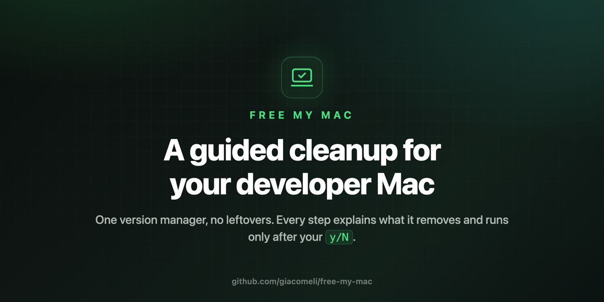
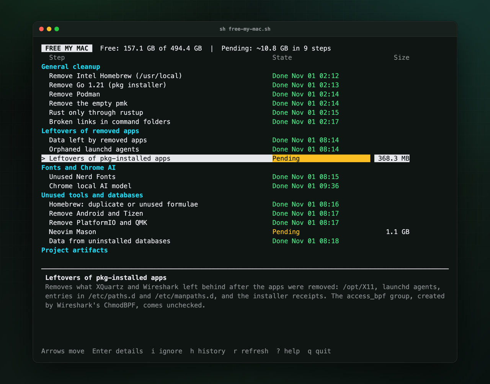
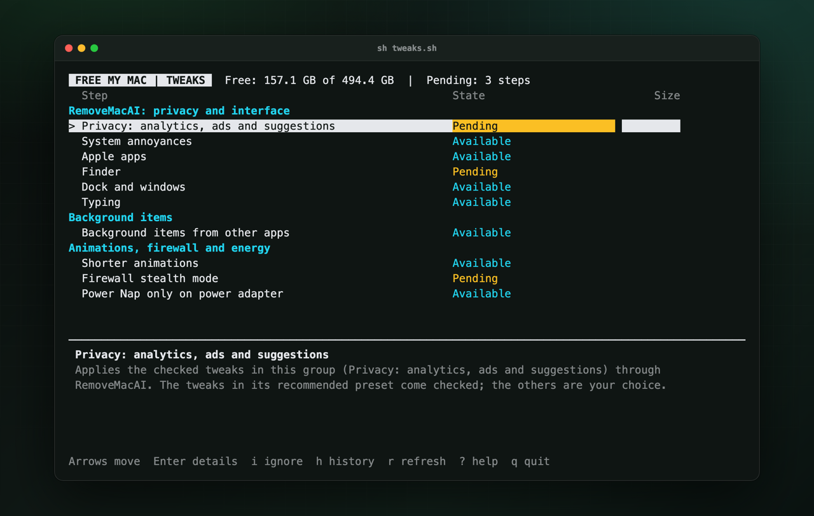
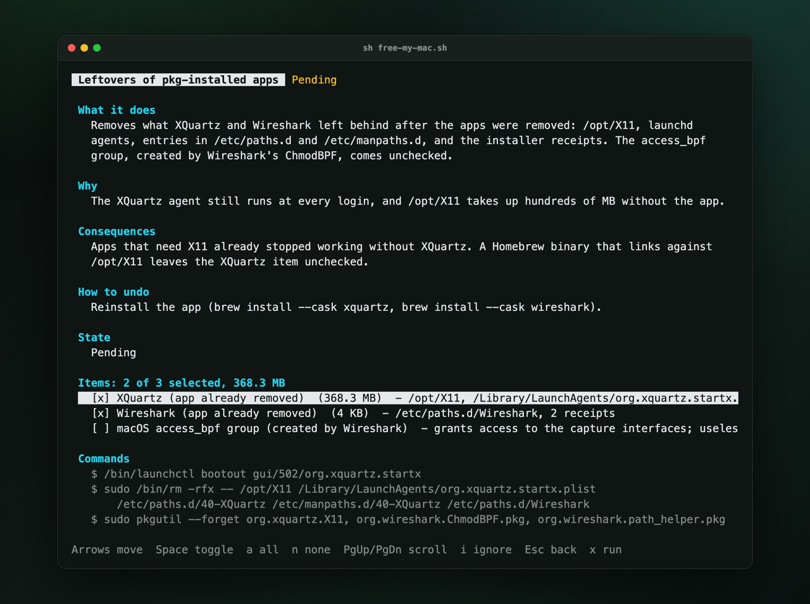
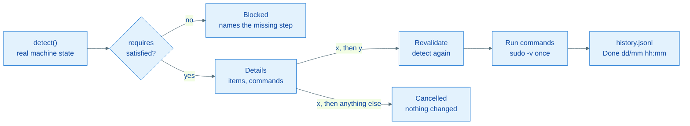

<p align="center">
  
</p>

<p align="center">
  A step-by-step cleanup and tuning tool for a macOS developer machine.<br>
  It explains every change, shows the exact commands and asks before running each one.
</p>

# Free My Mac

Free My Mac moves every language runtime to a single version manager
([mise](https://mise.jdx.dev), with [uv](https://docs.astral.sh/uv/) for Python packages and
rustup for Rust). Then it removes what other managers, installers and SDKs left behind: conda,
pyenv, fnm, Herd, Docker Desktop, .NET and Mono, iOS simulators, loose JDKs, pkg installers, orphan
launch agents, caches and build artifacts.

<p align="center">
  
</p>

- **Detects, then proposes.** Each step reads the real state of the machine. A step comes back as
  pending if what it removed comes back.
- **Explains before acting.** What the step removes, why, the consequences, how to undo it, and
  the exact commands it will run.
- **Asks every time.** A single-key `y/N` prompt, default no. Right before running, the step
  detects again and acts only on the selected items that still exist.
- **You pick the items.** Steps are split into items you can check or uncheck; optional ones
  come unchecked.
- **Keeps a record.** Every run goes to a history file, and backups go to a dated folder.
- **Nothing to install.** Python 3.9 standard library only, on the system `/usr/bin/python3`.
- **Tweaks mode.** A second catalog of reversible macOS debloat and tuning steps (`sh tweaks.sh`).

> [!NOTE]
> The catalog was written for one developer machine and its move to mise. On another Mac, steps
> whose targets are missing show as `Already clean` and do nothing. Nothing runs without
> your confirmation either way. To get the most out of it, fork it and adapt the catalog; names that
> only make sense on your machine go in a local file (see
> [Machine-specific settings](#machine-specific-settings)).

## Quick start

```sh
git clone https://github.com/giacomeli/free-my-mac.git
cd free-my-mac
sh free-my-mac.sh --list   # read-only: the state of every step
sh free-my-mac.sh          # interactive interface
```

## Requirements

- macOS with the Command Line Tools (`/usr/bin/python3`, 3.9 or newer). No third-party Python
  packages: the tool never removes the interpreter it runs on.
- Run as your user, **never with sudo**. Steps that touch system paths ask for the sudo password
  once, in the terminal, when they run.

## Usage

```sh
sh free-my-mac.sh                    # interactive interface (curses)
sh free-my-mac.sh --list             # state of every step, read-only
sh free-my-mac.sh --show conda-remove  # details and commands of one step, read-only
sh free-my-mac.sh --run conda-remove   # run one step after y/N confirmation
sh free-my-mac.sh --history          # past runs
sh free-my-mac.sh --projects ~/code  # projects folder (default: ~/Projects)
```

`--list`, `--show` and `--history` never write anything.

### Tweaks mode

```sh
sh tweaks.sh                         # interactive interface with the tweaks catalog
sh tweaks.sh --list                  # same options as free-my-mac.sh (--show, --run, --history)
```

<p align="center">
  
</p>

`tweaks.sh` runs `free-my-mac.sh --tweaks`: the same interface, confirmation, history and backup,
with a separate catalog of reversible debloat and tuning steps. Everything
[RemoveMacAI](https://github.com/omlahore/RemoveMacAI) already covers (privacy, Finder, Dock and
windows, typing, background items of other apps) is delegated to it with `removemacai apply`,
`undo` and `background`; free-my-mac only implements what it does not cover. Optional items come
unchecked; only clear recommendations come checked. The tool deliberately does not disable SIP,
Gatekeeper, FileVault or the firewall, does not `launchctl disable` Apple services, and does not
run placebo tweaks such as `sudo purge`.

| Group | Step | What it does |
| --- | --- | --- |
| RemoveMacAI | `rmai-privacy`, `rmai-annoyances`, `rmai-apps`, `rmai-finder`, `rmai-windows`, `rmai-typing` | Lists the RemoveMacAI tweaks of each group that are not applied yet (its `recommended` preset checked) and applies the selected ones; privacy tweaks go through its configuration profile, which you approve in System Settings |
| Background items | `background-items` | Background items of other apps, each with what stops working; turns off the selected ones with `removemacai background off`. Your own agents (`own_agent_prefixes` in `local.json`), the Warsaw bank security module and XQuartz are left out |
| Animations, firewall and energy | `ui-speed` | Shorter Dock, Mission Control, window and Quick Look animations; fixed Spaces order (all optional) |
| Animations, firewall and energy | `firewall-stealth` | Firewall stealth mode |
| Animations, firewall and energy | `battery-powernap` | Power Nap off on battery (optional) |

### Machine-specific settings

Names that only make sense on one machine stay out of the repository, in an optional
`~/.config/free-my-mac/local.json`:

```json
{
  "conda_projects": {"my_env": "group/my-project"},
  "uv_tools": {"some-cli": "git+https://github.com/owner/some-cli"},
  "own_agent_prefixes": ["dev.example."]
}
```

- `conda_projects`: conda environment -> project folder (relative to the projects folder) that gets
  a `.venv` with the same packages (`conda-migrate`).
- `uv_tools`: conda environment or pipx venv -> source for `uv tool install` that replaces it.
- `own_agent_prefixes`: label prefixes of your own launch agents, left out of `background-items`.

Without the file, `conda-migrate` only exports the environments to the backup and your agents
show up unchecked.

### Keys

| Screen | Keys |
| --- | --- |
| List | arrows or `j`/`k` move, `Enter` opens details, `i` ignores or restores a step, `h` history, `r` detects again, `?` help, `q` quits |
| Details | arrows move between items, `space` toggles an item, `a` selects all, `n` selects none, `x` runs (asks `y/N`), `Esc` goes back |

Execution leaves the curses screen and runs in the normal terminal: output is live, sudo asks
for the password there, and `Ctrl-C` interrupts. `Enter` returns to the list with the state
detected again.

## How a step works

Opening a step shows what it does, why, the consequences, how to undo it, its items and the exact
commands. `space` toggles an item and `x` runs the selection after the `y/N` prompt.

<p align="center">
  
</p>



| State | Meaning |
| --- | --- |
| Pending | There is something to do |
| Partial | Part of it was done (for example, one venv failed and was rolled back) |
| Done Nov 01 02:12 | Nothing left to do and the run is in the history |
| Already clean | Nothing to do and this tool never ran it (`Already applied` in tweaks mode) |
| Blocked | Depends on another step, which the panel names |
| Ignored | Skipped with `i`; dependent steps are released |
| Available | Recurring action with no detectable state |
| Detection failed | The message says why |

The state comes from detection, not from the history: if something comes back (for example, a
`brew upgrade` links a Python again), the step shows as pending again.

## Catalog

<details>
<summary>All 56 cleanup steps, by group</summary>

| Group | Step | What it does | Requires |
| --- | --- | --- | --- |
| Preparation | `backup` | Backup of shell files, `/etc/hosts`, `/etc/paths.d`, Brewfile, installer receipts, conda environments and venv package lists | - |
| mise | `mise-config` | Updates mise, enables `.nvmrc`/`.python-version`, disables the PHP plugin, `python.uv_venv_auto` | - |
| mise | `mise-python` | Installs the Pythons the projects use (3.11, 3.12 global, 3.14.6) | `mise-config` |
| mise | `mise-node` | Global Node LTS, pnpm 10 and Yarn 1 | `mise-config` |
| mise | `mise-projects` | Installs the versions pinned in each project | `mise-config`, `mise-python`, `mise-node` |
| Python | `venvs` | Rebuilds venvs whose base is not a mise Python, with the same packages and rollback | `mise-python`, `backup` |
| Python | `conda-migrate` | Moves the conda environments in use to uv (project `.venv`, `uv tool`); if the environment is already gone, rebuilds the `.venv` from the package list in the backup | `mise-python`, `backup` |
| Python | `conda-remove` | Removes Miniforge, conda and mamba | `backup`, `conda-migrate`, `venvs` |
| Python | `pipx-remove` | Removes pipx | `conda-migrate` |
| Python | `uv-only-mise` | uv never downloads its own Pythons | `mise-python`, `venvs`, `conda-migrate` |
| Python | `launchd-python` | Points launch agents that run a removed Python (or one about to leave the PATH) to the mise Python, in the plist and in the `.py` files next to the script | `mise-python` |
| Python | `brew-python-unlink` | Unlinks Homebrew Pythons (other formulas still use them) | `mise-python`, `venvs`, `launchd-python` |
| Python | `python-leftovers` | Python.org framework and empty pyenv | - |
| PHP and Herd | `herd` | Removes Herd and Valet configuration | - |
| PHP and Herd | `php-leftovers` | PHP wrapper, orphan `php.ini`, Composer, psysh, phpactor cache | - |
| PHP and Herd | `hosts-test` | Removes lines with only `.test` names from `/etc/hosts` | `backup` |
| Docker | `docker-desktop` | Official uninstaller: VM, images, containers, volumes, builders | - |
| Docker | `docker-leftovers` | `~/.docker`, caches, privileged helpers, broken links | `docker-desktop` |
| .NET | `dotnet-pkg` | .NET installed by pkg, PATH entries and receipts | - |
| .NET | `mono-xamarin` | Mono and Xamarin frameworks | - |
| .NET | `dotnet-brew` | .NET from Homebrew | - |
| .NET | `dotnet-user` | `~/.dotnet`, NuGet cache, templates | - |
| iOS simulators | `simulators` | All simulator runtimes, devices and the dyld cache; reports an orphan runtime left in `AssetsV2` (SIP-protected, not removable) | - |
| Node | `node-globals` | Reinstalls global CLIs from fnm as `mise use -g npm:<package>` | `mise-node` |
| Node | `fnm` | Removes fnm and its Node versions | `mise-node`, `node-globals` |
| Node | `node16` | Node 16 from the nodejs.org pkg and its global packages | - |
| Node | `node-leftovers` | npx cache, pnpm global store, loose bun and Yarn | `mise-node` |
| Java | `java-mise` | Temurin 21 as the global Java in mise | `mise-config` |
| Java | `java-old` | Loose JDKs, browser plugin, openjdk@17 and @21 | `java-mise` |
| General cleanup | `intel-brew` | The abandoned Intel Homebrew in `/usr/local` (only links that point into it) | - |
| General cleanup | `go-pkg` | Go installed by pkg | - |
| General cleanup | `podman` | Podman installed by pkg and Podman Desktop login item | - |
| General cleanup | `pmk` | Empty `/opt/pmk` and its PATH entry | - |
| General cleanup | `rust-brew` | Rust from Homebrew and rustup toolchains no project pins | - |
| General cleanup | `broken-links` | Broken links in `/usr/local/bin`, `/usr/local/sbin`, `~/.local/bin` | - |
| Leftovers of removed apps | `app-leftovers` | Data of apps that are no longer installed: old Electron WhatsApp, Adobe, Logitech Options, Riot, Oracle Java plugin, Fig, Wine, Dart/Flutter, Axway, OpenJFX cache | - |
| Leftovers of removed apps | `pkg-leftovers` | What pkg-installed apps left after the app was removed: XQuartz (`/opt/X11`, its launch agent, PATH entries, receipt) and Wireshark (PATH entry, receipts, optional `access_bpf` group) | - |
| Leftovers of removed apps | `launchd-orphans` | Launch agents and daemons whose program is gone, and broken plist links (Apple and Python agents excluded) | - |
| Fonts and Chrome AI | `nerd-fonts` | Nerd Font families no editor or terminal config uses (cask fonts and non-Nerd fonts stay) | - |
| Fonts and Chrome AI | `chrome-ai-model` | Installs a system configuration profile that forces the Chrome policy blocking the on-device model download (you approve it in System Settings), then deletes the model | - |
| Unused tools and databases | `brew-extras` | qemu, mysql-client@8.4, mongocli, SQL Server tools and empty taps | - |
| Unused tools and databases | `android-tizen` | Android command line tools, `~/.android` (debug keys backed up first) and the Tizen SDK | - |
| Unused tools and databases | `platformio-qmk` | PlatformIO, QMK and their ARM/AVR toolchains, taps and `~/.platformio` | - |
| Unused tools and databases | `nvim-mason` | Language servers downloaded by Mason for Neovim | - |
| Unused tools and databases | `orphan-db-data` | Data of databases whose server is gone (Homebrew MongoDB and PostgreSQL 14, EDB PostgreSQL 9.6), archived to the backup first | - |
| Project artifacts | `artifacts` | `target` (Rust), `.next` and `node_modules` of projects idle for 60+ days | - |
| Shell | `shell-rules` | Removes blocks for removed tools from `.zshenv`, `.zprofile`, `.zshrc` | `backup` |
| Shell | `cf-token` | Moves the Cloudflare token from the shell file to the Keychain | `backup` |
| Shell | `shell-old-files` | Old shell copies (backed up first, with `sudo install` for root-owned ones) and `.zcompdump*` | `backup` |
| Maintenance | `dev-caches` | mise cache, extracted crate sources, node-gyp headers, VS Code VSIX cache and obsolete extension versions, when above 100 MB | - |
| Maintenance | `npm-cache` | npm download cache, when above 100 MB | - |
| Maintenance | `uv-cache` | `uv cache clean`, when above 100 MB | - |
| Maintenance | `brew-cleanup` | Orphan dependencies (one item each) and `brew cleanup --prune=all` | - |
| Maintenance | `xcode-derived` | Xcode DerivedData | - |
| Maintenance | `cowork` | Turns off the Claude Cowork VM and deletes `vm_bundles` | - |
| Maintenance | `apple-intelligence` | Runs the third-party RemoveMacAI to turn off Apple Intelligence | - |

</details>

## Safety

- **Nothing runs without confirmation.** Before running, the step detects again and acts only
  on the selected items that still exist.
- **Removal.** Paths in your home are removed in Python without following symlinks and refusing
  mount points. Paths outside your home use `sudo /bin/rm -rfx`, which does not cross
  filesystems. Installer receipts are forgotten with `pkgutil --forget`.
- **Venvs and conda.** A venv is renamed, rebuilt and only deleted after the new one installs
  every package; if anything fails, the old one comes back. Package lists are saved to the backup.
- **Shell files.** Each rule removes an exact block, and only when its target no longer exists.
  Personal lines are not touched. The new file must pass `zsh -n`, a copy of the previous version
  is kept, and the write is atomic. Diffs are shown with secrets masked.
- **Secrets.** The Cloudflare token goes to the Keychain through standard input, so it never
  appears in the process list. It is never printed, never written to the history, and variables
  whose name looks like a secret are masked in every displayed command.
- **Never touched:** Xcode, `/usr/bin/python3`, `~/.claude`, `~/.codex`, `~/.ollama`, `~/.npmrc`,
  aws-cli, heroku, and any project source code. Git-tracked folders are never treated as
  build artifacts.

## Files

| Path | Content |
| --- | --- |
| `~/.local/state/free-my-mac/history.jsonl` | Run history (mode 600, append-only) |
| `~/bkp/free-my-mac/YYYY-MM-DD/` | Backups and exports (mode 700) |

The backup of shell files may contain secrets that were in them (such as the Cloudflare token
before `cf-token`). Delete old backups when you no longer need them.

## Development

```sh
/usr/bin/python3 -m unittest discover -s tests
```

| Path | Role |
| --- | --- |
| `free_my_mac.py` | Command line and dispatch |
| `fmm/core.py` | Model (`Step`, `Item`, `Detection`, `Op`), `Context`, state resolution |
| `fmm/runner.py` | Revalidation, execution, sudo, history |
| `fmm/text.py`, `fmm/ui.py` | Text modes and curses interface |
| `fmm/paths.py` | Declarative `PathsStep` (paths, receipts, formulas, casks, taps) |
| `fmm/shellfiles.py` | Shell file rules and Keychain |
| `fmm/pyenvs.py` | mise Pythons, venvs and conda helpers |
| `fmm/steps/` | The catalog, one module per group |

Tests run in a temporary home and root (`tests/helpers.py`): commands are answered by fakes and
nothing touches the real machine.

### Adding a step

Most removals are declarative. Create the class in the module of its group and add it to that
module's `STEPS` list:

```python
class Podman(PathsStep):
    id = 'podman'
    group = 'general'
    title = 'Remove Podman'
    targets = ('/opt/podman', '/etc/paths.d/podman-pkg', '~/.local/share/containers')
    receipts = r'^com\.redhat\.podman'
    what = 'Deletes Podman installed by pkg ...'
    why = 'Containers now run on a remote server.'
    consequences = 'The podman command goes away.'
    undo = 'Reinstall from the Podman website.'
```

For anything else, subclass `Step` and implement `detect(ctx) -> Detection` (read-only, using
`ctx.query`, `ctx.user`, `ctx.sys`) and `ops(ctx, items) -> List[Op]` (each `Op` has a label, the
command shown to the user and either an `argv` or a Python `func`). Declare `requires` when the
step only makes sense after another one.
